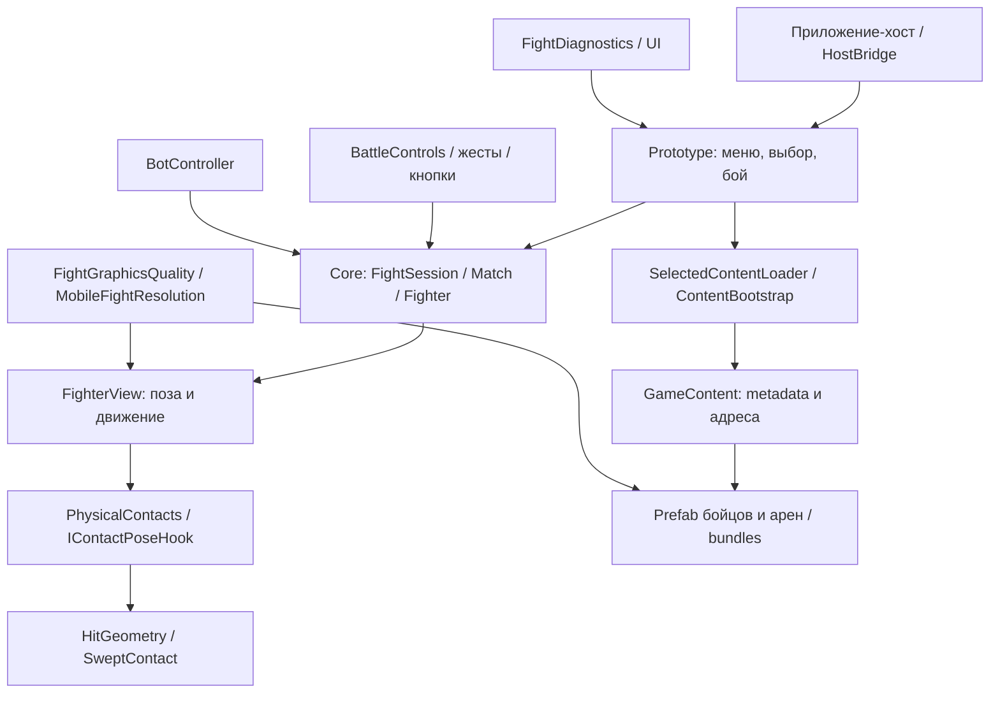
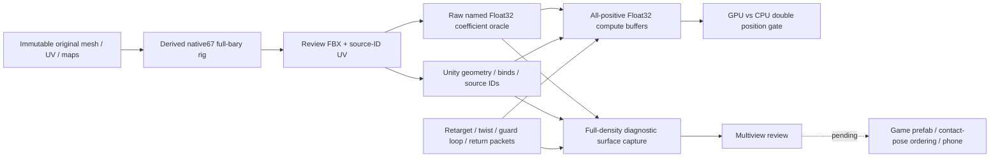

# Архитектурная карта LighFight

Обновлено 2026-10-19. Карта существующего кода, а не обещание готовности функций.

## Где искать изменения

| Область | Основные файлы / папки | Ответственность |
|---|---|---|
| Правила боя | `unity/Assets/LighFight/Core/` | Match, Fighter, ходы, бот, жесты, тайминг, геометрия контактов |
| Меню и состояние приложения | `unity/Assets/LighFight/Runtime/Prototype*.cs`, `FightSelection.cs`, `FightOptions.cs` | Навигация, выбор бойцов/арены и параметры |
| Ввод | `BattleControls.cs`, `AttackButtonBindings.cs`; Core: StrikeGesture, JoystickGuard | Кнопки, свайпы, перемещение, блок |
| Представление бойца | `FighterView.cs`, `NativeRigBones.cs`, `NativeFingerPose*.cs`, `JointCorrectives.cs` | Анимационные позы, кости, пальцы, локальные коррекции; наличие компонента не означает назначение всем prefab |
| Контакты | `PhysicalContacts.cs`, `IContactPoseHook.cs`; Core: HitGeometry, SweptContact | Согласование видимой позы и проверки попадания |
| Контент | `GameContent.cs`, `ContentBootstrap.cs`, `SelectedContentLoader.cs`, `ContentDownloader.cs`, `ContentStorage.cs` | Метаданные, inline/addressable каталоги, загрузка/освобождение |
| Арены | `OfficeArena.cs`, `MeetingSpectators.cs`, `SeatedSpectatorPose.cs`, `MeetingHookahInteraction.cs` | Декорации, зрители с исключением активных бойцов, взаимодействия |
| Нагрузка | `FightGraphicsQuality.cs`, `MobileFightResolution.cs`, `FightDiagnostics*.cs` | Профили качества, разрешение, FPS и тепловая диагностика; нагрев остаётся открытым P0 |
| Сборка/импорт/аудиты | `unity/Assets/LighFight/Editor/`, `unity/Assets/Native67SpatialReview/Editor/` | Редакторские задания; review-инструменты не равны shipping runtime |
| Автоматические проверки | `unity/Assets/LighFight/Tests/` | Проверки логики и контрактов, отдельно от визуальной/телефонной приёмки |
| Веб-макет нового UI | `prototypes/roster-portraits/` | Экспериментальный UI и Babylon-превью, не телефонная сборка |
| Исходники и производные | `art/source/`, `art/references/`, `art/drafts/`, `art/portraits/` | Original assets, фото, кандидаты, портреты |

Имена Runtime в таблице разрешаются внутри `unity/Assets/LighFight/Runtime/`.

## Правила границ

- Core задаёт состояние боя; визуальные Animation Events не должны самостоятельно наносить урон.
- Импортированный original хранится неизменным. Rig/исправления/экспорт создаются как производные с контрольными суммами.
- Веб-превью, Unity editor review, embedded-каталог и установленная сборка — разные этапы. Проверка одного не доказывает готовность остальных.
- Правки плеч должны применяться после выборки движения и до финального skinning/снятия контактной позы. Их перенос в runtime ещё требует отдельной проверки порядка обновления.
- Профиль iPhone и его нагрев оцениваются на устройстве; сохранение полной исходной сетки не является доказательством приемлемой нагрузки.

## Состояние и решения

- Приоритеты/приёмка: [BACKLOG](../backlog/BACKLOG.md).
- Текущий контракт персонажей: [CHARACTER_PIPELINE](art/CHARACTER_PIPELINE.md).
- История импорта: [ART_PIPELINE](ART_PIPELINE.md). Начальные разделы исторические: старые 8 бойцов/Humanoid-контракт не описывают автоматически нынешние native67-кандидаты.
- Доставка контента: [CONTENT_DELIVERY](CONTENT_DELIVERY.md).
- Отчёты измерений: `docs/reports/`; доказательства и кандидаты: `art/drafts/`.

## Контур полной детализации персонажей, 2026-10-19

Это существующий **диагностический** контур. Назначение в игровой runtime ещё открыто.

Стандартные FBX skin weights Unity нельзя считать authority: фактически выявлены округление и потеря части положительных влияний даже при выключенной компрессии. Raw Float32 coefficients хранятся отдельно; полный состав исправлений задаёт `art/drafts/full-roster-v1/native67-full-density-recipe-v2.json`.

Оркестратор `art/drafts/full-roster-v1/run_existing_dense_recipe.py` последовательно выполняет export, raw oracle, import, GPU gate, loop/transition gate, surface capture. Он проверяет фактический exitCode Unity из process JSON; успешный exit Python-обёртки не считается успешным Unity gate. Автоматического назначения в каталог, сборки или установки он не делает.
